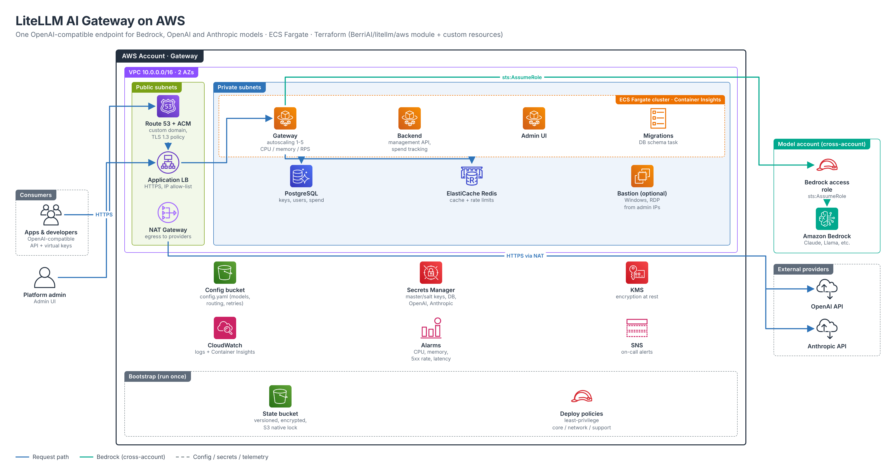

# LiteLLM AI Gateway on AWS (Terraform)

Self-hosted **LiteLLM** gateway on AWS that gives teams one OpenAI-compatible endpoint for **Amazon Bedrock**, **OpenAI** and **Anthropic** models, with virtual keys, spend tracking, caching, retries and latency-based routing. Built with Terraform on top of the official `BerriAI/litellm/aws` module, plus the pieces it doesn't cover: cross-account Bedrock access, S3-hosted model config, provider key secrets, alarms, DNS/TLS, a bootstrap stage and verification scripts.



> Built from a staging deployment I delivered, sanitized for public use. Company name, account IDs and bucket names were replaced with example values (`acme`, `111122223333`).

---

## What it does

- **One endpoint, many models.** Apps call the gateway with the OpenAI SDK. LiteLLM routes to Bedrock (Claude, Llama, etc.), OpenAI or Anthropic.
- **Cross-account Bedrock.** Models run in a separate AWS account. The gateway task role assumes `BedrockCrossAccountAccessRole` there, so no provider keys are needed for Bedrock.
- **Config without redeploying Terraform.** `configs/config.yaml` (models, routing, retries, prompt caching) lives in a versioned S3 bucket. Upload a new version and force a new ECS deployment.
- **Keys and spend.** Virtual keys, users and spend are stored in PostgreSQL. Redis handles caching and rate limits.
- **Secrets stay in Secrets Manager.** Master key, salt key, DB password and optional OpenAI / Anthropic keys are injected into tasks at runtime. Nothing sensitive lives in `.tfvars`.

---

## Architecture

| Layer | Resources |
|---|---|
| Edge | Route 53 alias + ACM certificate (optional), ALB with TLS 1.3 policy and source CIDR allow-list |
| Compute | ECS Fargate: **Gateway** (autoscaling on CPU, memory or requests per second), **Backend**, **Admin UI**, **Migrations** task. Container Insights on |
| Data | PostgreSQL (keys, users, spend), ElastiCache Redis (cache, rate limits) |
| Network | VPC across 2 AZs, ALB + NAT in public subnets, everything else private |
| Config & secrets | S3 config bucket (versioned, encrypted, public access blocked), Secrets Manager + KMS |
| Model access | IAM policy allowing `sts:AssumeRole` into the Bedrock account, plus outbound HTTPS to OpenAI / Anthropic through NAT |
| Monitoring | CloudWatch logs, alarms for gateway CPU, memory, ALB 5xx rate and latency, SNS topic |
| Admin access | Optional Windows bastion (RDP from listed admin IPs only) with `psql` and `redis-cli` preinstalled |

### Two-stage deployment

1. **`terraform/bootstrap/`** (run once): Terraform state bucket (versioned, encrypted, S3 native locking, deletion protection), config bucket, and three least-privilege IAM policies for whoever deploys (core / networking / supporting).
2. **`terraform/main/`**: the gateway itself, using the bootstrap bucket as its backend.

---

## Quick start

```bash
# 1. Bootstrap (state bucket, config bucket, deploy policies)
cd terraform/bootstrap
# edit terraform.tfvars: tenant, environment, aws_region
terraform init && terraform apply

# 2. Point main/backend.tf at the state bucket from the bootstrap output

# 3. Upload the model config
aws s3 cp ../../configs/config.yaml s3://<tenant>-<env>-litellm-config/config.yaml

# 4. Deploy the gateway
cd ../main
export TF_VAR_anthropic_api_key="..."   # optional, only for direct Anthropic access
terraform init
terraform apply -var-file=../environments/staging.tfvars

# 5. Check it
../../scripts/smoke-tests.sh --from-terraform
```

Full walkthrough: [terraform/README.md](terraform/README.md). Day-2 runbook (force deploys, rollback, state recovery, key rotation, DB restore): [terraform/OPERATIONS.md](terraform/OPERATIONS.md).

---

## Verification scripts

| Script | What it checks |
|---|---|
| `scripts/validate.sh` | `terraform fmt`, `terraform validate`, `tflint` (rules in `terraform/.tflint.hcl`) |
| `scripts/security-scan.sh` | Checkov: S3 encryption and public access blocks, RDS encryption, secret handling, security group exposure |
| `scripts/plan-verify.sh` | Reads a plan and flags unexpected deletions, resource counts per type, and overly open security group rules |
| `scripts/smoke-tests.sh` | Live endpoint: liveness, readiness, model list, a test chat completion |
| `scripts/integration-tests.sh` | AWS CLI checks of the deployed state: VPC, ECS services, ALB, database, Redis, secrets, CloudWatch logs |

GitHub Actions runs format, validate and Checkov on every push.

---

## Notes on the staging example

`environments/staging.tfvars` is sized for a small team (one gateway task scaling to five, `db.t4g.medium`, `cache.t4g.micro`) and runs **HTTP only** with the ALB open to `0.0.0.0/0`, which was acceptable for that staging setup. For production:

- set `acm_certificate_arn` (or `domain_name` + `hosted_zone_id`) and `allow_plaintext_alb = false`
- restrict `alb_allowed_cidr_blocks` to your networks or put the ALB behind WAF / a private endpoint
- add Redis replicas and raise task counts

---

## Repository layout

```
.
├── configs/config.yaml            LiteLLM model list, routing, retries, caching
├── terraform/
│   ├── bootstrap/                 state + config buckets, deploy IAM policies
│   ├── main/
│   │   ├── main.tf                BerriAI/litellm/aws module wiring
│   │   ├── ecs_iam.tf             Bedrock cross-account + config bucket access for tasks
│   │   ├── secrets.tf             provider API key secrets + resource policies
│   │   ├── dns.tf                 ACM certificate, validation, Route 53 alias
│   │   ├── security_groups.tf     extra SG rules
│   │   ├── cloudwatch_alarms.tf   CPU, memory, 5xx, latency alarms + SNS
│   │   ├── bastion.tf             optional Windows bastion
│   │   └── variables.tf / outputs.tf / backend.tf / versions.tf
│   ├── environments/staging.tfvars
│   ├── README.md                  deployment guide
│   └── OPERATIONS.md              runbook
├── scripts/                       validate, security scan, plan verify, smoke, integration
└── docs/images/
```

---

## Tech stack

Terraform · AWS (ECS Fargate, ALB, RDS PostgreSQL, ElastiCache Redis, S3, Secrets Manager, KMS, IAM, Route 53, ACM, CloudWatch, SNS, Amazon Bedrock) · LiteLLM · Checkov · tflint · Bash

## License

MIT
